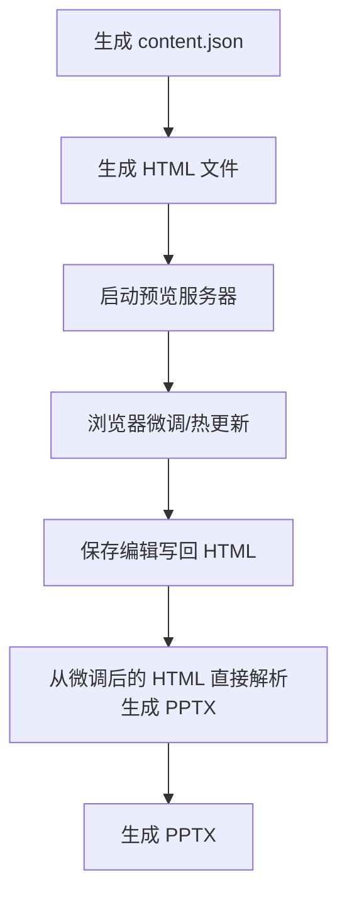

# HTML 预览模式（路径 B）

> ⚠️ 本文件仅在用户**明确选择 HTML 模式**后才加载。默认生成 PPTX，不走此路径。

当用户在交付格式询问中明确选择"生成 HTML 预览"时，按以下步骤执行。

## 工作流程



**视觉设计遵循 design-taste-frontend 原则：**
- DESIGN_VARIANCE: 8（非对称布局，避免三列卡片，用 Zig-Zag / 分屏）
- MOTION_INTENSITY: 6（页面切换动效，hover 微交互）
- VISUAL_DENSITY: 4（大量留白，内容呼吸感）
- 字体：Geist / Outfit / Satoshi，禁用 Inter
- 配色：单强调色，饱和度 < 80%，禁用 AI 紫蓝渐变
- 禁止：无霓虹光晕、无纯黑(#000)、无过度渐变文字、无标题下划线

## 步骤 B1：生成内容 JSON

将检索到的内容写入 JSON 文件 `content.json`：

```json
{
  "title": "AI发展趋势报告",
  "theme": "midnight-executive",
  "lang": "zh",
  "slides": [
    { "layout": "cover", "data": { "title": "AI发展趋势报告", "subtitle": "2025-2026年行业深度洞察" } },
    { "layout": "content", "data": { "title": "全球AI市场规模", "items": ["2025年全球AI市场规模达4500亿美元", "年复合增长率(CAGR)预计为20%", "生成式AI市场增长最为迅猛"] } },
    { "layout": "data", "data": { "title": "核心数据", "metrics": [{"label": "市场规模", "value": "4500亿美元"}, {"label": "年增长率", "value": "20%"}, {"label": "生成式AI占比", "value": "30%"}] } },
    { "layout": "split", "data": { "title": "方案对比", "items": ["要点1", "要点2"] } },
    { "layout": "timeline", "data": { "title": "发展路线", "steps": [{"title": "阶段一", "desc": "基础建设"}, {"title": "阶段二", "desc": "规模化应用"}] } },
    { "layout": "comparison", "data": { "title": "方案A vs 方案B", "left": {"title": "方案A", "items": ["优势1", "优势2"]}, "right": {"title": "方案B", "items": ["优势1", "优势2"]} } },
    { "layout": "end", "data": { "title": "谢谢", "subtitle": "Q&A" } }
  ]
}
```

**可用布局类型：**

| 布局 | 适合内容 | 视觉特征 |
|------|---------|---------|
| `cover` | 封面 | 左文右图，非对称 2:1 分栏 |
| `content` | 文字要点 | 左对齐标题 + 圆点列表 |
| `data` | 核心数据 | 3列网格卡片 |
| `split` | 图文并茂 | 1:1 分栏，左文右色块 |
| `timeline` | 流程/阶段 | 水平步骤条 |
| `comparison` | 两方对比 | 左右对比列 |
| `end` | 结尾致谢 | 居中 |

## 步骤 B2：生成 HTML 文件

```bash
node scripts/generate_html.js --input content.json --output output/presentation.html --theme midnight-executive
```

生成的 HTML 是自包含文件，内含：
- 所有幻灯片（1280x720 像素，16:9）
- 主题 CSS（根据配色方案动态生成）
- 编辑器 JS（内联编辑、导航、工具栏）
- 键盘导航（← → 切换页面，Esc 退出编辑）

## 步骤 B3：启动预览服务器（支持热更新）

```bash
node scripts/serve_preview.js --html output/presentation.html --port 3000
```

自动打开浏览器，用户可以看到：
- 底部控制栏：上一页 / 下一页 / 编辑模式 / 导出 PPTX
- 编辑模式下，顶部工具栏：字号 / 颜色 / 加粗斜体下划线 / 对齐
- **热更新支持**：服务器会自动监听 HTML 文件变化，用户编辑 HTML 后浏览器自动刷新

## 步骤 B4：用户微调内容（实时预览）

用户有两种方式微调：

**方式一：通过编辑器 UI 微调**
- 点击"编辑模式" → 所有文字区域变为可编辑
- 直接点击文字修改内容
- 通过工具栏调整字号、颜色、对齐
- 键盘 ← → 切换页面预览
- 点击"预览模式"退出编辑
- **微调完成后点击"保存编辑"按钮**，将编辑内容写回 HTML 文件（详见 B4.5）

**方式二：通过代码编辑器修改 HTML（推荐）**
- 用户用 VS Code 或其他编辑器打开 HTML 文件
- 修改 HTML 内容后保存
- **浏览器自动刷新**，立即看到修改效果
- 无需手动刷新，实现所见即所得的编辑体验
- 代码编辑器修改的文件已直接写入磁盘，无需额外保存步骤

## 步骤 B4.5：保存编辑（重要！）

用户在浏览器中微调后，**必须先点击"保存编辑"按钮**，将编辑后的内容写回 HTML 文件：
- 点击"保存编辑" → 浏览器克隆当前 DOM → 移除编辑器 UI（控制栏/工具栏/contenteditable）→ POST 干净的 HTML 到 `/api/save-html` → 服务器写回 HTML 文件
- 保存成功后，HTML 文件已包含所有微调内容
- **不保存直接导出会导致微调内容丢失**

## 步骤 B5：导出 PPTX（从微调后的 HTML 直接解析）

用户确认内容并保存后，点击"导出 PPTX"按钮，或运行：

```bash
# 需要安装依赖: npm install cheerio pptxgenjs
node scripts/html_to_pptx_direct.js --input output/presentation.html --output output/presentation.pptx
```

转换原理（样式感知，不依赖 puppeteer）：
1. 用 cheerio 解析 HTML，读取每个 `<section class="slide" data-layout="...">` 的 `data-layout` 属性识别布局类型
2. 从 CSS `:root` 变量提取主题配色（--primary / --secondary / --accent 等）
3. 从每个元素的内联 `style` 属性提取 color / fontSize / fontWeight / textAlign 作为样式覆盖
4. 用 pptxgenjs 构建原生 PPTX 元素（文本框、矩形、圆角矩形、椭圆），应用提取的样式
5. 无内联样式覆盖时使用 palette 默认值，有覆盖时优先使用覆盖值

**降级方案**：如果没有 Node.js，可用 Python 版本：
```bash
pip install beautifulsoup4 python-pptx
python scripts/html_to_pptx_direct.py --input output/presentation.html --output output/presentation.pptx
```

## 步骤 B6：视觉检查

生成后必须检查：
- 文字是否溢出
- 配色是否统一
- 布局是否整齐
- 内容是否完整
- 非对称布局是否遵循 design-taste-frontend 原则

## 依赖安装

```bash
# 生成 HTML（Node.js，无外部依赖）
# generate_html.js 是纯 Node.js，无需安装依赖

# HTML → PPTX 直接解析（Node.js，样式感知）
npm install cheerio pptxgenjs

# HTML → PPTX 直接解析（Python 降级方案，样式感知）
pip install beautifulsoup4 python-pptx
```
